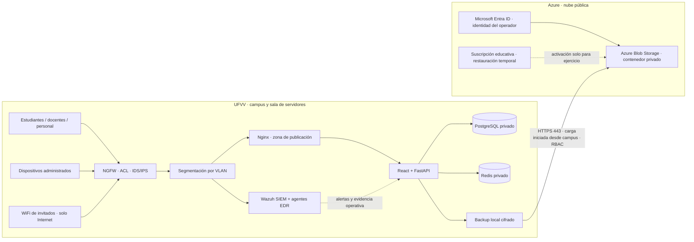

# Diseño de arquitectura híbrida

## Decisión

Se mantiene el procesamiento principal en un laboratorio local que representa la sala de servidores del campus. La aplicación, PostgreSQL, Redis, almacenamiento de reportes y registros operativos viven en Docker Compose dentro de una red no expuesta directamente. Azure se utiliza para una copia externa cifrada de los respaldos y para un punto de recuperación de demostración activado bajo demanda. Así se conserva control local sobre el sistema académico y se añade una copia fuera del sitio sin mantener una máquina virtual o una VPN facturándose todo el mes.

La propuesta usa Azure for Students por el contexto académico y porque el titular reporta disponer de acceso educativo. El código incluido provisiona solamente un grupo de recursos, una cuenta de almacenamiento y un contenedor privado; no se ha desplegado. El acceso cloud a datos se limita a HTTPS saliente con Microsoft Entra y RBAC. El plan de costos está separado en [plan-azure.md](plan-azure.md).

## Diagrama lógico

## Zonas y flujos

| Zona/VLAN | Uso | Acceso permitido |
|---|---|---|
| VLAN 10 | Gestión de red e hipervisores | Solo estación administrativa con MFA y salto controlado |
| VLAN 20 | Servidores y datos | API a PostgreSQL/Redis; administración desde VLAN 10 |
| VLAN 30 | Personal docente y administrativo | HTTPS a aplicaciones institucionales; sin acceso directo a bases |
| VLAN 40 | Laboratorios y estudiantes | HTTPS a LMS/SIS; sin acceso a gestión ni backend |
| VLAN 50 | Dispositivos móviles/BYOD | Acceso a servicios aprobados; cuarentena si no cumplen postura |
| VLAN 60 | WiFi de invitados | Internet únicamente; aislamiento cliente a cliente |
| Zona DMZ | Nginx/reverse proxy y WAF administrado si hay crédito | HTTPS entrante; API únicamente por red de aplicación |

Flujos requeridos: (1) usuario→Nginx 443; (2) Nginx→API 8000 en red interna de aplicación; (3) API→PostgreSQL 5432 y Redis 6379 solo en red backend; (4) trabajador→PostgreSQL/Redis y almacenamiento de reportes interno; (5) backup→Azure Blob por HTTPS 443 saliente, con cifrado previo y Microsoft Entra RBAC; (6) agentes→SIEM por puerto interno autorizado. Denegar por defecto los flujos no enumerados. La topología de Compose actual representa únicamente la separación lógica API/bases, no la instalación de VLAN, DMZ o NGFW físico.

## Componentes

| Componente | Decisión | Estado |
|---|---|---|
| Aplicación | React, FastAPI, PostgreSQL, Redis y Celery en contenedores | Ejecutable localmente; uso académico |
| Borde | Nginx/TLS, reglas WAF en la publicación real | Nginx local; WAF pendiente |
| Identidad | Roles por función, TOTP MFA; Entra para el operador Azure | Roles/MFA opcional en el sistema; Entra/RBAC en plantilla Azure |
| Red | NGFW, IDS/IPS, VLAN y DMZ con denegación por omisión | Diseño; la red Compose es segregación de contenedores limitada |
| Monitoreo | Wazuh/Suricata para laboratorio, eventos de API y SO | No desplegado en el Compose de base |
| Respaldo | Copia local cifrada y réplica externa Blob | Script local existente; plantilla cloud y carga preparados |
| Alta disponibilidad | 2 hosts, PSU/UPS redundante y réplica de aplicación | Objetivo de diseño; no presente en el equipo local |
| Móvil | MDM, MFA y acceso por aplicación | Política; requiere licencias y enrolamiento reales |

## Zero Trust

La identidad y el dispositivo se verifican para cada acceso: cuentas individuales, MFA para docentes y personal, roles de menor privilegio, elevación temporal de administradores, sesiones cortas, revisión trimestral de membresías y revocación al egreso. El dispositivo móvil institucional exige cifrado, bloqueo, actualización y borrado remoto; un BYOD sin postura solo obtiene servicios web de bajo riesgo. La ubicación de red reduce exposición pero no concede confianza automática. La API conserva autorización por organización y auditoría; la futura integración con Entra deberá validar emisor, audiencia, MFA y contexto de sesión.

La opción de mínimo costo no incluye Azure VPN Gateway ni endpoints privados. El campus inicia la transferencia de respaldo hacia Azure por HTTPS con acceso RBAC; el contenedor no es anónimo y no concede permisos a usuarios finales. Esto ofrece separación y recuperación fuera de sitio, pero no es una red privada extendida ni una nube de cómputo en alta disponibilidad. Cualquier requisito de conectividad privada se presupuesta como fase posterior.

## Límites de implementación

Docker Compose verifica una aplicación local con servicios de datos en redes internas. Un diagrama, una plantilla Bicep, las políticas y los supuestos no prueban instalación real de Azure, segmentación de campus, SIEM, EDR, MDM, DLP o centro de datos. El registro de [estado y evidencia](10-evidencias-y-estado.md) identifica pruebas por ejecutar y evita presentar diseño como configuración real.
